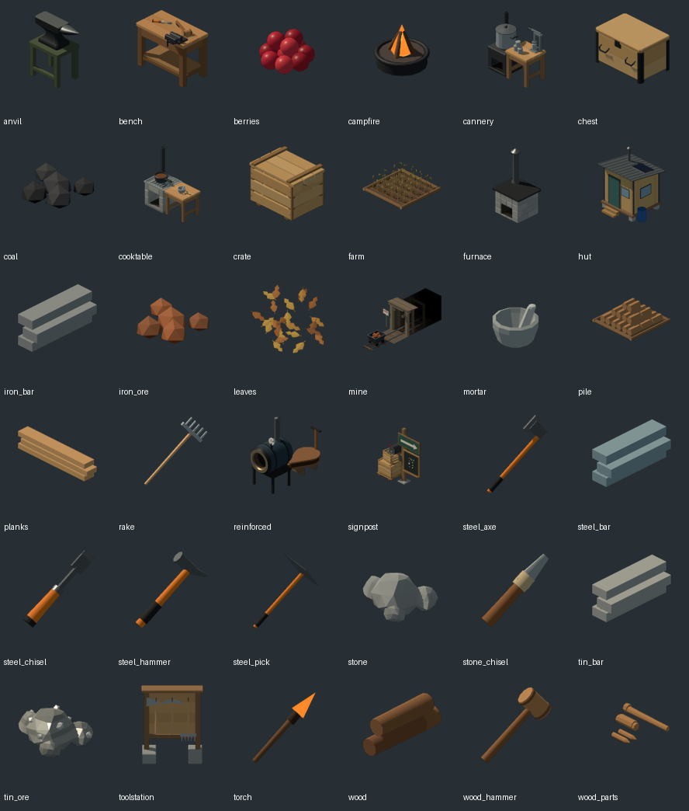

# Icon review: candidate additions

Reviewed the committed `assets/icons/*.png` set on 2026-10-27. The contact sheet below shows the actual current artwork at a common display size; labels are the filenames. Suggestions below are for future additions only and do not change current assets.

## Similarity and confusion risks

- **Steel hammer and steel pickaxe** are the most confusable pair at small inventory size. Both use a long orange-brown diagonal handle and a dark gray wedge-shaped head; the pick's point and hammer's opposite faces can blur at thumbnail scale. Keep the pick head sharply pointed and make the hammer head read as a compact block with a broad striking face.
- **Steel axe and steel chisel** also share a warm handle and dark blade, so their silhouettes can converge when scaled down. Keep the axe's broad side blade and the chisel's short, narrow cutting edge distinct.
- **Stone and steel chisels** are differentiated in the current sheet: the stone chisel has a pale, chunky head, while the steel chisel has a dark narrow blade and brighter handle. Preserve that material contrast in any later redraw.
- **Wood and steel hammers** are less confusable than the steel hammer and pickaxe: the wooden mallet has a broad rounded brown head, while the steel hammer's head is gray and angular. Keep those head shapes and colors distinct in future variants.
- **Mine and signpost/trading post** are not especially similar in silhouette. The mine icon is a dark timber headframe with a black tunnel and cart; the signpost is a small board beside stacked crates. They are distinguishable, though the mine's dark opening loses detail on dark UI backgrounds. A future mine variant could lift the timber and cart values while retaining the black tunnel as its focal point.
- **Water/bottle:** there is no active water or bottle icon in `assets/icons/`. `docs/DESIGN.md` notes the historical art board's water flask is the only comparison-board image still used. For a new active bottle icon, use a clear flask silhouette with a visible fill level and stopper; make filled and empty states distinct through liquid color/level rather than relying on tiny labels. For a lake/source icon, use a broad blue water shape rather than another small container silhouette.

## New icon proposals

1. `assets/icons/water_bottle.png`: a compact, slightly faceted reusable tin or glass flask with a stopper and obvious blue water line. Keep its silhouette narrow-necked so it cannot be mistaken for the mortar (open bowl) or torch (long shaft, orange tip). If inventory needs a separate empty state, lower or remove the blue fill while retaining the flask outline.
2. `assets/icons/water_source.png` (only if a world-source item needs an inventory/panel icon): a small pool or lake ripple viewed isometrically, broad and horizontal with a bright blue center. Avoid depicting a bottle here; the existing `assets/icons/mine.png` already represents a world building and the water source should likewise read as terrain.
3. **Future steel hammer refinement:** keep its current handle direction, but make the head a compact gray block with a broad striking face. This would separate it from `assets/icons/steel_pick.png`, whose pointed wedge is clear in the larger sheet but similar at small size.

The contact sheet is a review artifact, not a replacement atlas; no source icon was modified.
