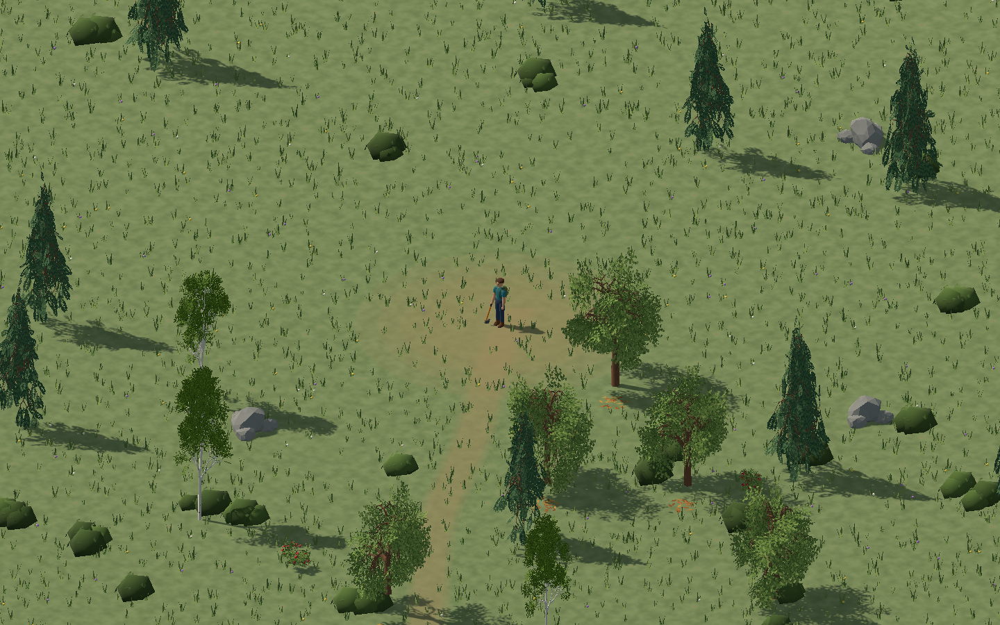
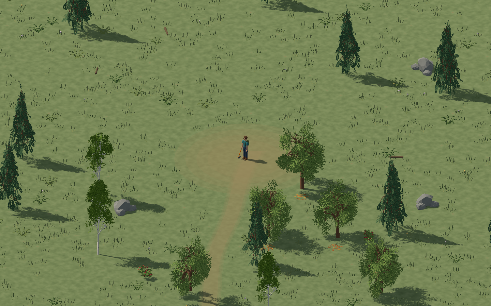
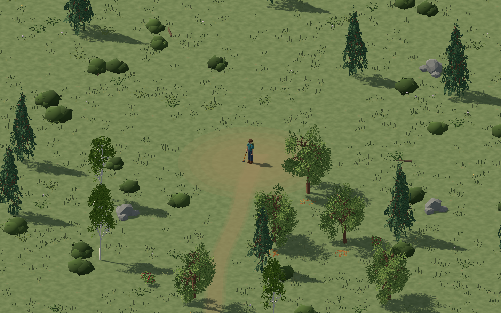
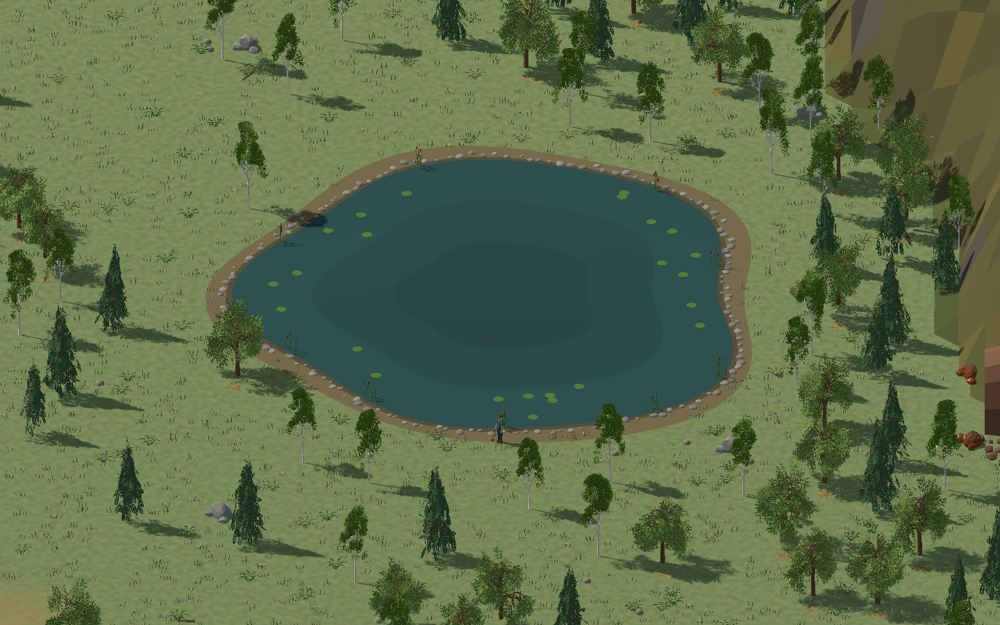
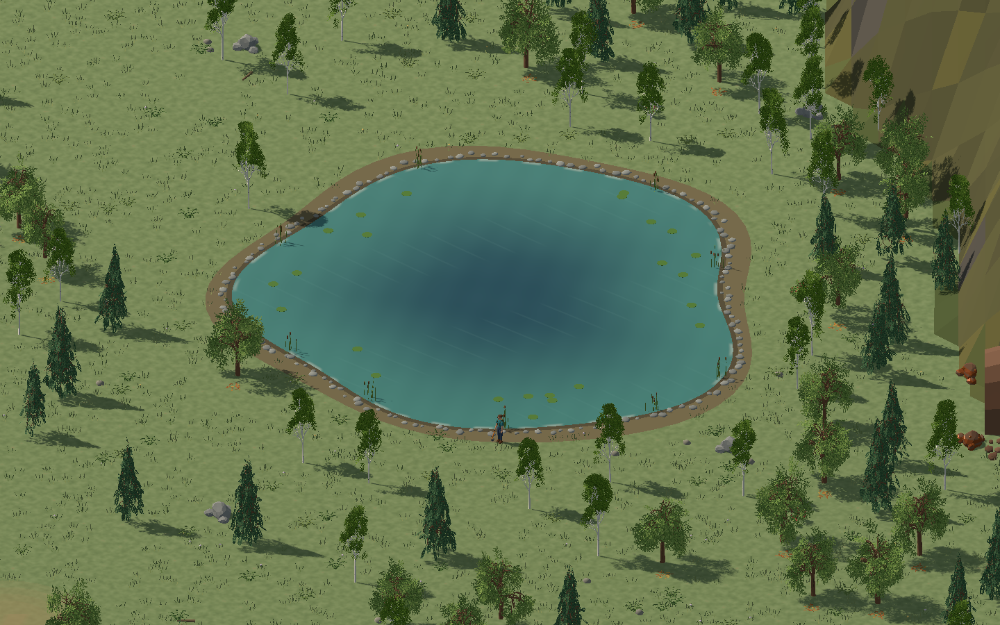
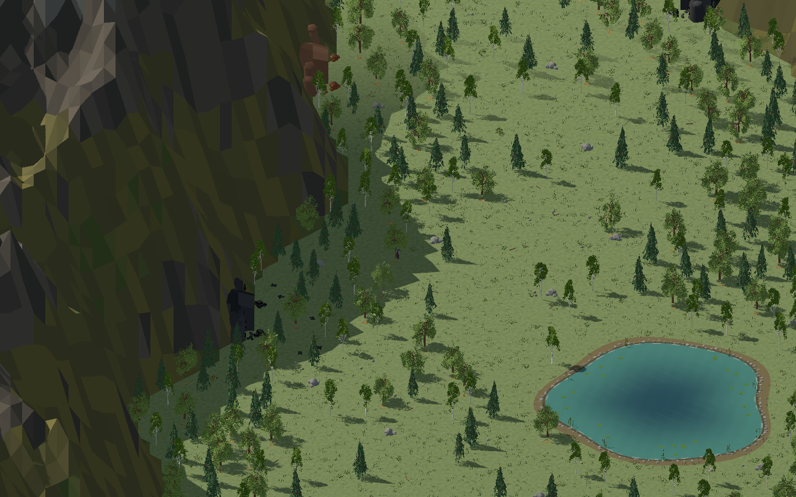
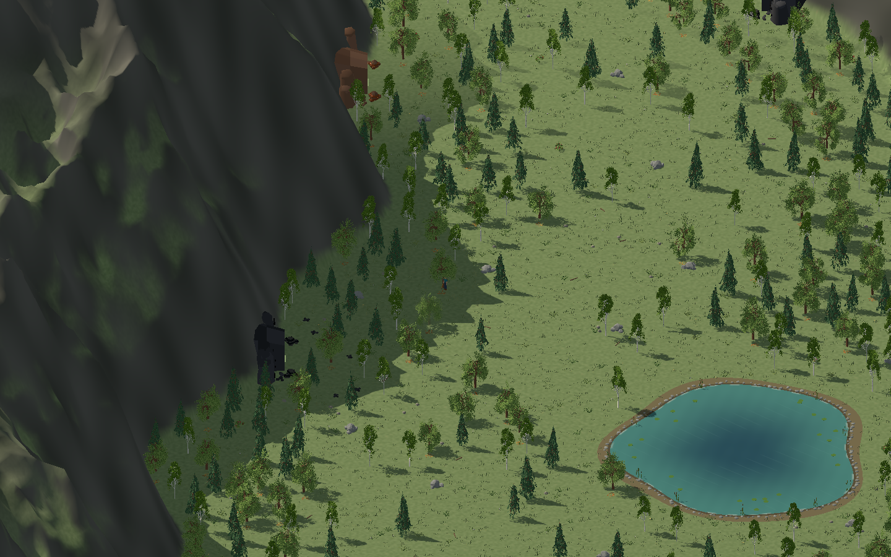

# Default environment and historical trials

The changes documented here began as separate trials on `codex/terrain` and are
now part of the default game environment. The before/after images and trial
notes below are historical records; the before images are retained for
comparison and are not produced by the current capture script.

The subsequent [shoreline and mine blending pass](SHORELINE_AND_MINES.md)
extends the water shader to the coast, softens banks and blends the mine rock
into the mountains.

## 1. Environment placement

Forest placement is enabled by default.

ProtonScatter generates 40,000 fixed-seed candidate transforms offline. The game
loads the committed JSON once, filters wet ground, the clearing, cart trail,
resource footprints and mine approaches, then builds six shared MultiMeshes:
meadow patches, ferns, ordinary bushes, flowers, pebbles and twigs. These are decorative; resource
trees and berry bushes keep their simulation positions and gathering rules.
The forest fixture contains 7,600 meadow patches, 331 ferns, 269 bushes, 183 flowers,
60 pebbles and 35 twigs. The original trial's tufts were replaced by the baked
placement set.
The initial placement masks use the loaded world layout. After merging main, a
shared disturbance texture also clears plants around newly placed buildings,
mine approaches and the cart trail, and shades worn soil on native terrain.
It updates only when the world layout changes.

Upstream is MIT, pinned to commit
`7198cc00078ebde61307578137c3f35223c6e438`. Regenerate with
`./tools/scatter.py`; downloads remain under ignored `.tools`. Two independent
bakes produced SHA-256
`14c2648589f67a4d32a0f383c48e4839dfa27356d4a4ad26f9a5004b7cf96ee1`.
See `assets/environment/proton_scatter/README.md` and its adjacent license.

| Before | After |
| --- | --- |
|  |  |

The original trial omitted non-berry shrubs. The follow-up restores clustered
shrubs with the same shared scrub mesh as the default scenery, sampled from the
baked candidates without changing any other plant placements. It adds one
MultiMesh during loading and no per-frame work. This updated forest view shows
the current environment improvements:



The former placement screenshot above is retained as a historical reference.
Capture the current default view with:

```sh
./build.py play -- --showcase --environment-review forest --screenshot /absolute/path/after.png
```

The comparison fixture freezes simulation at daylight, hides interface and fog,
and uses the same world seed, camera, zoom and viewport (1440×900). It is a
visual-review fixture, not evidence of a complete gameplay playthrough.

## 2. Lake appearance

The lake shader is enabled by default.

The lake uses a bounded shader adapted from Boujie's Gerstner normal and
Fresnel equations, pinned to source commit
`25f3c2da458e0a4f65bdb5903dc068b050930c06` under MIT. The surface stays at the
existing water height and follows `Terrain.Shore`. Its shallow teal edge,
deeper blue center, animated ripple normals and broken foam replace the three
flat water discs. Banks, reeds, stones and lily pads retain their positions.
This is an adaptation of shader math, not installation of Boujie's ocean
plugin. The radial depth colors are authored; no real lake bed, refraction,
fluid simulation or buoyancy is added. See `assets/environment/lake/README.md`.

| Before | After |
| --- | --- |
|  |  |

```sh
./build.py play -- --showcase --environment-review lake --screenshot /absolute/path/after.png
```

Both frames show the entire surrounding resource layout with the player on
the dry bank. Shader time is fixed to 1.25 seconds in the review fixture.

## 3. Terrain3D

Terrain3D rendering is enabled by default.

Terrain3D's native clipmaps replace the original plane and faceted mountain
mesh. Nine padded heightmap regions use the existing mountain height function;
the playable valley floor remains level, keeping the current movement,
picking, building and shoreline rules. Terrain detail follows the viewed
ground rather than the distant orthographic camera. The generated Terrain3D
shader retains its height, normal and LOD paths, with project grass/rock colors,
fog of war and cutouts below the five mine entrances. Collision remains owned
by the simulation; this does not add walkable hills, sculpting UI or digging.

The pinned upstream MIT release is `v1.1.0-rc1` (a release candidate), archive
SHA-256 `549d0c1d45982ae2e30d90275f754a9c7174b8f57eb600bc93a8108b98d44636`.
Setup installs its Linux x86_64 libraries under ignored
`addons/terrain_3d`; the archive stays in `.tools/terrain3d`. This runtime
requirement means the game setup currently targets Linux x86_64. No external
checkout or incomplete generated C# wrapper classes are required. See
`assets/environment/terrain3d/README.md` for provenance and the
isolated native API probe.

| Before | After |
| --- | --- |
|  |  |

```sh
./build.py play -- --showcase --environment-review terrain --screenshot /absolute/path/after.png
```

The wider terrain fixture moves the orthographic camera above the peaks in
both images. Add `--review-fog` to inspect the normal exploration mask instead
of revealing the whole view. Regenerate the current forest, lake and terrain
views with `./tools/environment_review.py`; it updates only the after images.

## Validation and practical limits

- Fixed-seed ProtonScatter output matched across two independent bakes.
- The original trial validation recorded successful compilation, formatting,
  simulation, input/UI, network, Linux export and executable smoke checks.
- All comparison frames were rendered with Forward+ and visually inspected.
  Additional mine and exploration-fog views checked native terrain alongside
  the existing objects. The exported executable also rendered all three
  trials together, including the baked placement JSON and native library.
- The first Godot 4.7.2 import of Terrain3D can exit with signal 11 after editor
  initialization; the next import and game launch succeeded. The launcher
  preserves a log and retries once only for this specific native import exit
  with no engine errors. Repeated failures or engine errors still fail setup.
- The [local performance run](PERFORMANCE.md) records measured frame times on
  one development machine before the subsequent main merge. Lake depth is
  an authored visual approximation. Terrain3D preserves level-ground gameplay;
  native physics, player terrain editing and pathfinding on slopes are outside
  these appearance trials.
