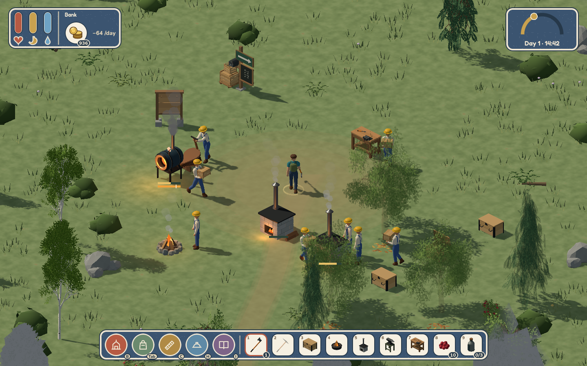

# Local environment performance run — 2026-10-28

The default environment completed a rendered six-minute run on an Intel Core
i9-14900HX and NVIDIA GeForce RTX 4080 Laptop GPU (driver 615.71.09), using Godot
4.7.2 .NET, Forward+/Vulkan, a 1440×900 window, disabled VSync and no FPS cap.
This was the development build launched by `build.py`, not a release-build
comparison or a minimum-spec hardware test.

After 15 seconds of warmup, the first 240 measured seconds covered a complete
day/night lighting cycle: forest, lake, coast, iron, tin, coal, upper valley and
forest edge. The clock ran at 3.5×; simulation, movement, production and animation
kept their normal frame delta. Area changes used fixed position jumps followed
by actual WASD input walking; those changes and first-view costs remain in the
measurements. The player was kept fed, hydrated and healthy for repeatability.

The next 120 seconds focused on a daytime settlement with eight assigned workers:
a two-person bellows forge, two staffed iron furnaces, a chisel-equipped planks
bench, a campfire, stockpiles and wage reserves. Normal hauling, lunch, commuting
and production logic ran. This is a supplied test fixture, not a progression
playthrough. Autosave was disabled and benchmark files use a separate prefix.

| Scenario | Average FPS | 95th percentile frame | 99th percentile frame | Worst frame |
| --- | ---: | ---: | ---: | ---: |
| Daytime walking | 237.9 | 9.47 ms | 12.28 ms | 140.54 ms |
| Nighttime walking | 166.5 | 12.31 ms | 15.23 ms | 36.91 ms |
| Staffed production | 162.0 | 10.82 ms | 13.58 ms | 116.50 ms |
| Entire run | 198.3 | 10.35 ms | 13.50 ms | 140.54 ms |

There were 71,396 measured frames and 1,561 world units walked (including warmup,
excluding position jumps). Eighty-six frames exceeded 16.67 ms, five exceeded
33.33 ms, and two exceeded 50 ms. Routes and camera contents differ between day
and night, so these numbers do not isolate the cost of nighttime lighting.

Across the fixture run, including warmup, the forge completed 21 batches, each iron furnace 44, and the bench 28. Four
stations were in the processing state concurrently; that state can include a
station waiting for its operator or heat. The narrower active-worker counter
counts pumping/hammering/gathering, excluding walking and hauling. All workers
ended without wage debt or a blocked-path status.

No engine errors occurred. Godot-reported static memory moved from 185.6 to
183.0 MiB (peak 186.4 MiB), with no sustained growth during this run. GPU render
time averaged 1.31 ms; reported video memory peaked at 133.4 MiB. These results
do not identify a reason to retain the superseded scenery renderers.

Two isolated hitches remain worth profiling: 140.54 ms just after dawn at
211.35 seconds, and 116.50 ms during production at 308.14 seconds. Neither
coincided with a managed collection or a high measured GPU render time. The
run does not establish their cause; it would be premature to attribute them
to Terrain3D or dismiss them as harmless. Managed allocations averaged about
802 bytes/frame overall and 1,374 during the production segment, including
instrumentation and rare events. This is higher than the simple walking UI
fixture and identifies busy-settlement allocations as a useful profiling target.



The committed [summary](../reviews/performance/2026-10-28-summary.json) includes
per-location measurements and the slowest frames. The [run metadata](../reviews/performance/2026-10-28-run.json)
records route positions, station batches and final worker statuses. Raw frame
CSV and the engine log stay under ignored `build/`.

Reproduce with:

```sh
./build.py play -- --performance-run /absolute/path/to/results
python3 tools/performance_report.py /absolute/path/to/results
```

The harness preallocates sample storage, records cumulative allocation/GC
counters, and writes its reports and final screenshot after sampling ends.
Frame percentiles use actual monotonic wall-clock intervals; GPU render timing
is enabled on the viewport. Godot process-time monitor readings are included
in raw data but are not used to attribute individual hitch causes.
