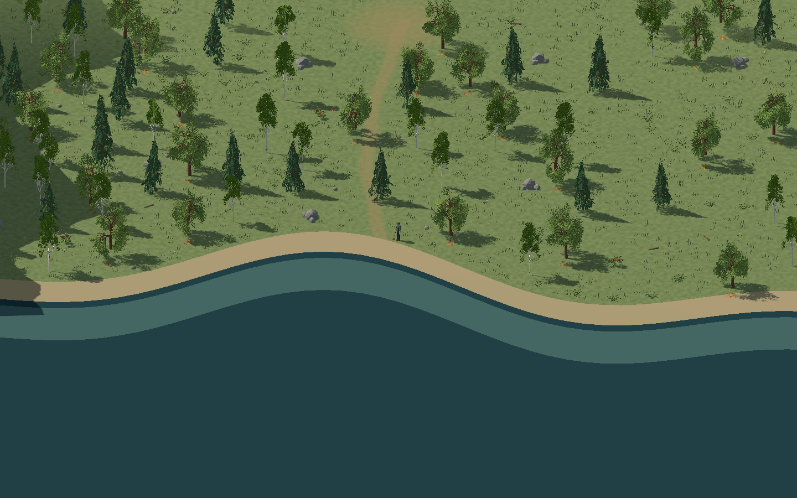
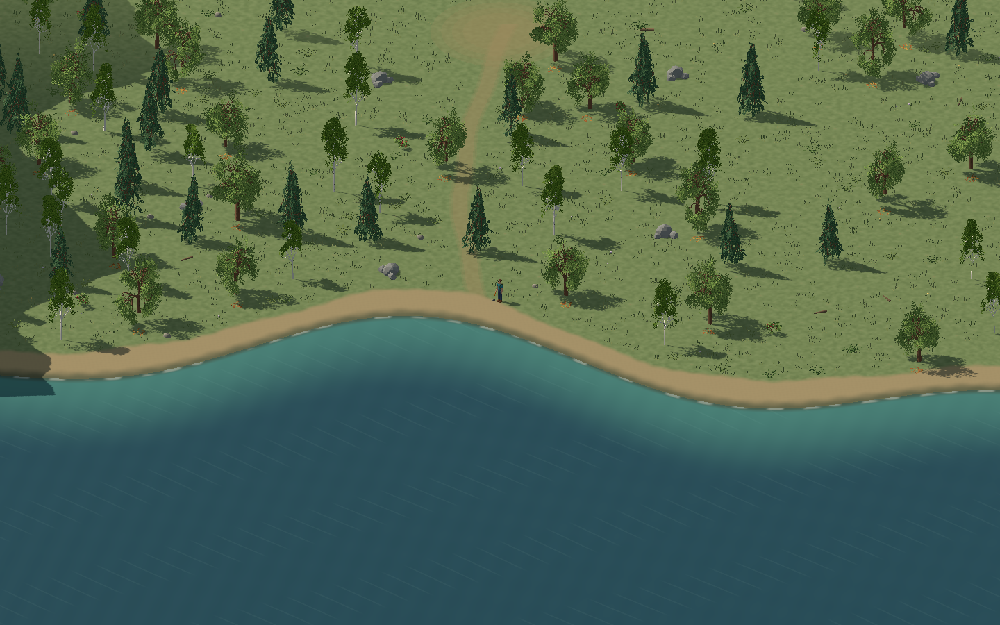
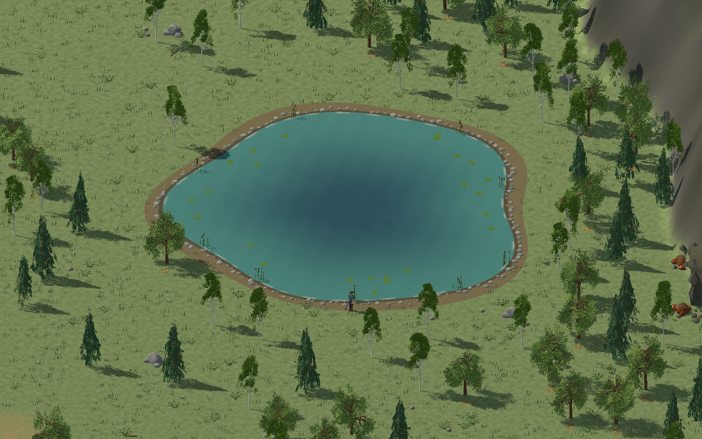
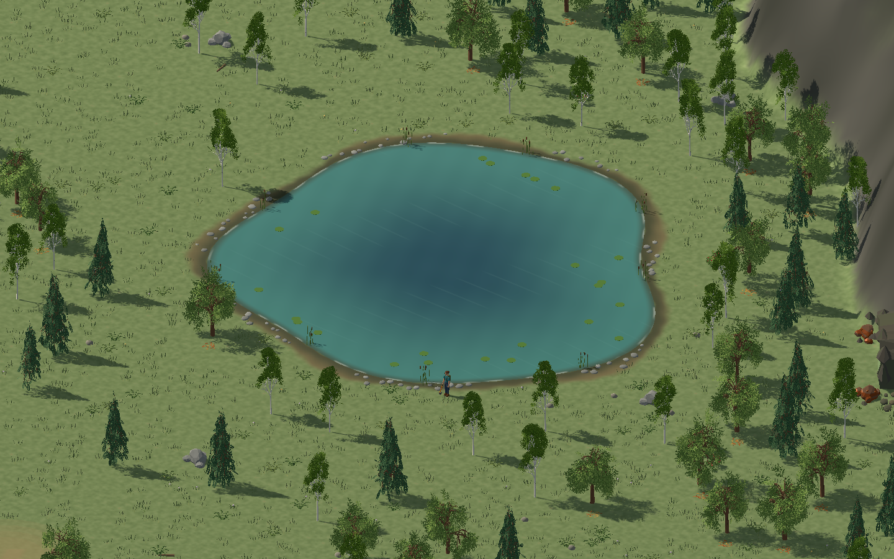
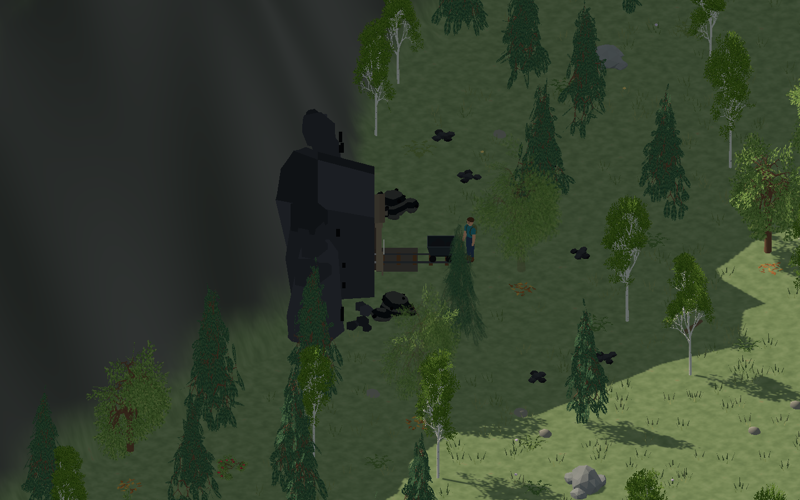
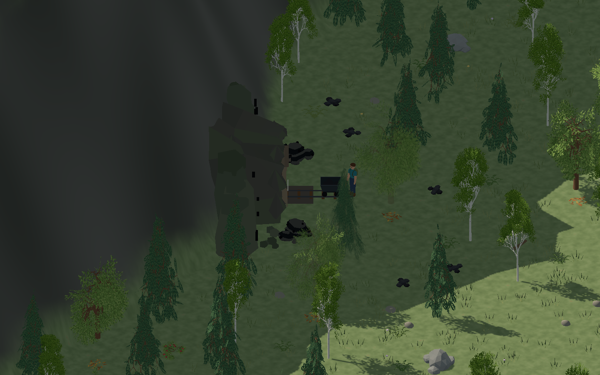
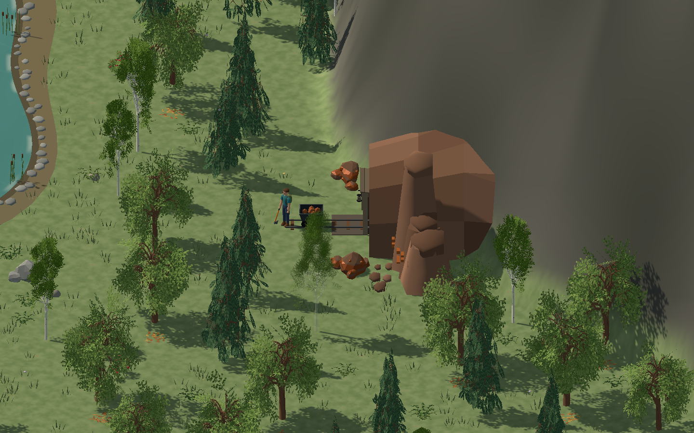
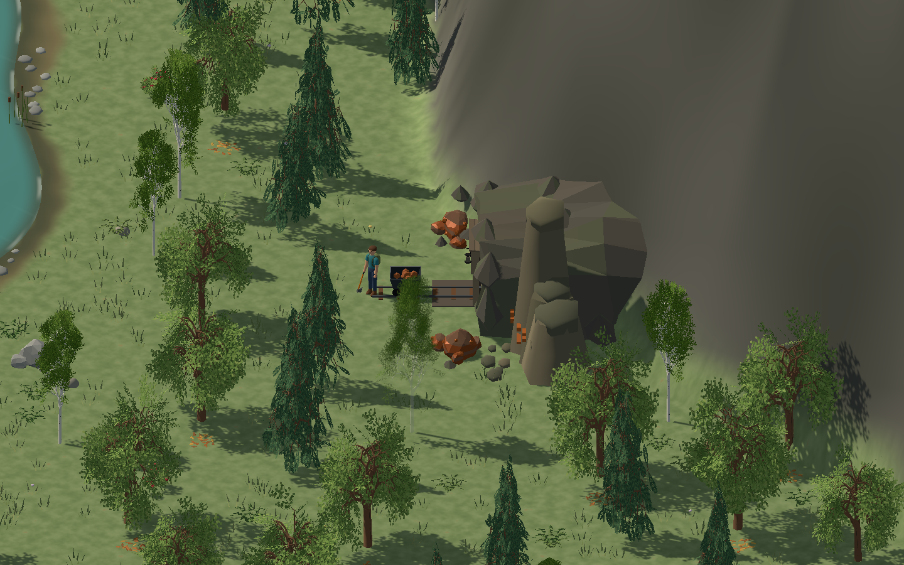
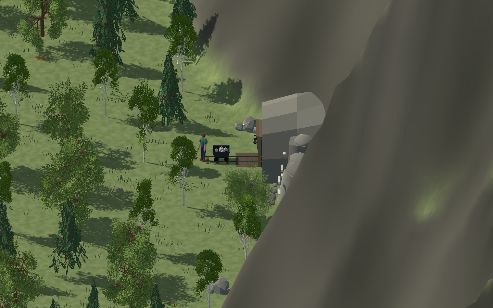
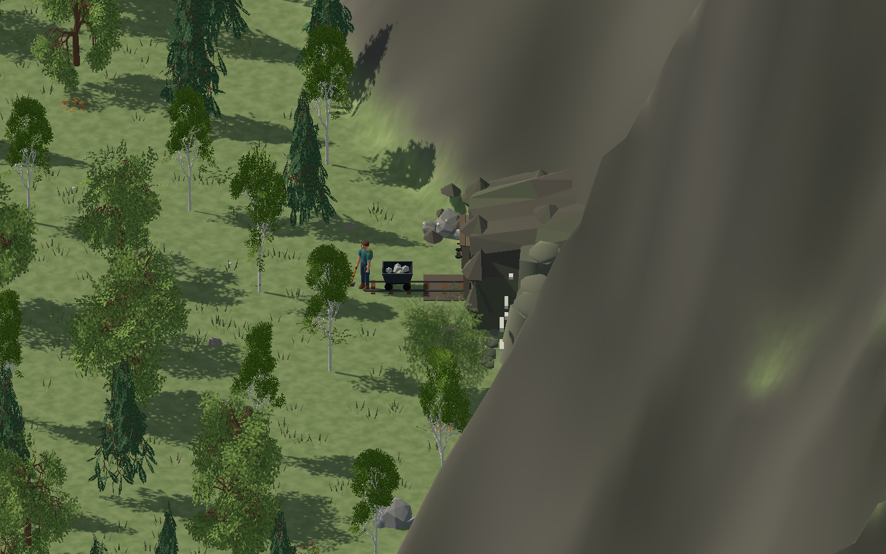

# Shoreline and mine blending

The shoreline and mine appearance changes are part of the default environment.
The paired screenshots preserve historical before images for reference.

```sh
./build.py play
```

The lake and coast now share calm water shading. The coastline's uniform
shallow-water stripe is replaced by a distance-based color gradient and thin,
broken foam wash. Narrow wet banks fade into variable-width soil or sand,
then grass. Lake stones collect in irregular patches instead of a regular
bracelet. These are visual changes: water height, shoreline geometry used by
walking, water collection, and the cart route retain their simulation rules.

## Coast and lake

| View | Before | After |
| --- | --- | --- |
| Coast |  |  |
| Lake edge |  |  |

## Mine sites

The rock shells have irregular shoulders and depth offsets instead of a few
straight arch segments. Partly embedded angular boulders break the front,
side and crown seams; small talus stones sit at the exposed feet, outside the
rails. Terrain3D sites use subdued host-rock colors that meet the mountain
palette, with ore indicated by seams, deposits and cart contents. The original
tunnel-aperture corners remain in place; construction, rail placement and
worker navigation are unchanged. Added geometry is merged into the existing
cached site mesh during loading.

| Site | Before | After |
| --- | --- | --- |
| Coal |  |  |
| Iron |  |  |
| Tin |  |  |

## Reproduce the review

```sh
./tools/environment_review.py --shoreline
```

This captures the current coast, lake-edge and three mine views with fixed
daylight, camera and shader time. Review fixtures now ignore
input so a mouse-wheel event cannot alter the comparison zoom. Mine before
images were captured before the geometry edit and are retained as historical
references. The fixture is for visual inspection, not a gameplay playthrough.

For an individual view, use `--showcase --environment-review coast`,
`--showcase --environment-review lake`, or
`--showcase --environment-review mine --mine-ore iron` with
`--screenshot /absolute/path.png`. Add `--review-fog` to inspect exploration
fog.

The historical validation recorded successful compilation and C# formatting,
simulation, input/UI and two-process network checks. Existing checks still
enforce the low outcrop
height and fully buried rear edge. Forward+ screenshots cover both banks,
all three ore sites and exploration-fog boundaries. Transparent banks apply
fog in their own shader so they cannot reveal unexplored shorelines.
